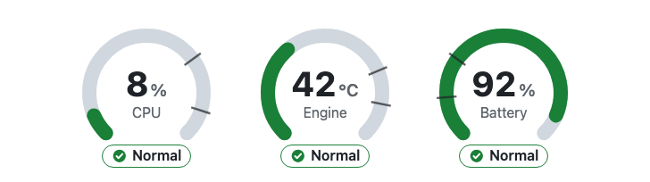

# `<ui-gauge>` — a Lit Web Component

[](https://github.com/vofack/lit-gauge-demo/actions/workflows/storybook-pages.yml)

**Live demo (Storybook): https://vofack.github.io/lit-gauge-demo/**



A small, accessible circular gauge built with [Lit](https://lit.dev) and TypeScript, made to learn Web Components.

- SVG arc with **warning** and **critical** thresholds (higher-is-worse or lower-is-worse)
- Styled from the outside with **CSS custom properties** and `::part()`, light and dark schemes
- **Accessible**: `role="meter"` with ARIA values; the status is always written in words, with a distinct icon shape — never colour alone
- Status exposed as a **CSS custom state**: `ui-gauge:state(critical)`

## Usage

```html
<script type="module" src="./dist/ui-gauge.js"></script>

<ui-gauge value="72" unit="%" label="CPU" warning="70" critical="90">
  Updated 2 min ago
</ui-gauge>
```

## API

| Property / attribute | Type | Default | Description |
|---|---|---|---|
| `value` | number | `0` | Current reading. Out-of-range values are shown as read; the arc stops at the limits. |
| `min` / `max` | number | `0` / `100` | Range (a reversed range is swapped). |
| `unit` | string | `''` | Unit shown after the value. |
| `label` | string | `''` | Visible label and accessible name. |
| `warning` | number | — | Warning threshold. |
| `critical` | number | — | Critical threshold. If lower than `warning`, lower values are worse (battery, fuel). |
| `status` (read-only) | `'normal' \| 'warning' \| 'critical'` | | Computed status. |

**Slot** — default slot: extra text under the gauge.

**CSS custom properties** — `--ui-gauge-size`, `--ui-gauge-thickness`, `--ui-gauge-track-color`,
`--ui-gauge-color-normal`, `--ui-gauge-color-warning`, `--ui-gauge-color-critical`, `--ui-gauge-text-color`,
`--ui-gauge-muted-color`, `--ui-gauge-font-family`, `--ui-gauge-transition`.

**CSS parts** — `meter`, `track`, `indicator`, `threshold`, `value`, `label`, `status`.

## Development

Requires Node 22. On the author's Mac, run `source ./setup-env.sh` first (keeps caches on an external disk).

```sh
npm ci
npm run dev              # demo page (Vite)
npm run storybook        # Storybook on http://localhost:6006
npm test                 # tests in Chrome (web-test-runner + open-wc + axe)
npm run typecheck
npm run build            # library to dist/
npm run build-storybook  # static Storybook to storybook-static/
npm run capture          # regenerates docs/gauge.gif
```

Every push to `main` runs the tests and publishes Storybook to GitHub Pages (`.github/workflows/storybook-pages.yml`).

## License

[MIT](LICENSE)
